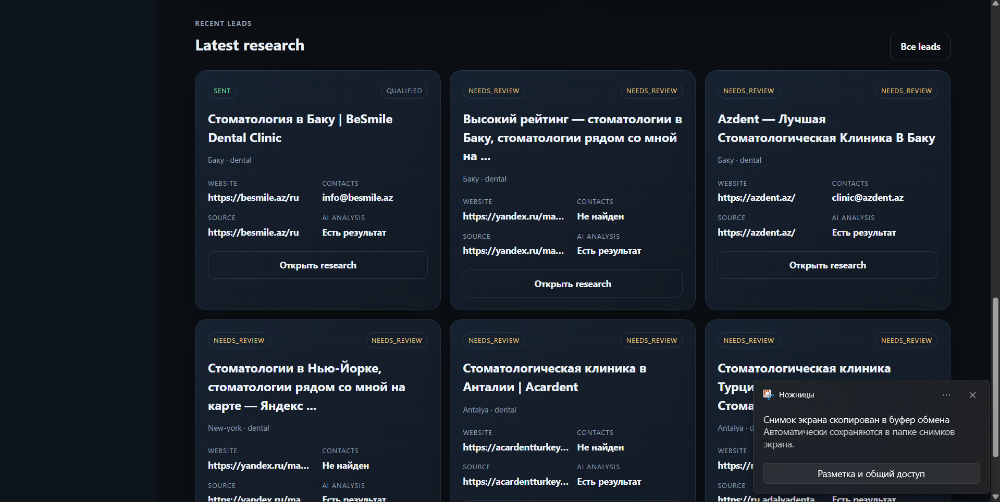

# Yernar Ibadulla

## YERNAR OS / ORBITAL EDITION

The portfolio and **EVENT HORIZON** now share one React application and one live black-hole scene. Open projects on the orbital desktop, enter the observatory, explore five chapters, then return to your existing project windows. The original laptop studio remains available through **Войти в студию**.

```sh
npm ci
npm run dev -- --port 5180
```

Open `http://127.0.0.1:5180/portfolio/`. Production: `npm run build`; GitHub Pages bundle: `npm run build:pages` (writes `docs/`, matching this repository's hosting configuration). Physics checks: `npm run test:physics`. Browser regression suite: `npm test`.

Routes: `#desktop`, `#observatory/1` through `#observatory/5`, `#studio`, `#studio/desktop`, `#products`, `#products/dentara`. Terminal commands: `open event-horizon`, `open products`.

## Digital Products

The Digital Products app uses the existing YERNAR OS window system and preserves the shared EVENT HORIZON renderer. DENTARA is listed at a planned **$19 USD base price**, **In review**; no purchase link is shown until a real marketplace listing is available.

`public/products.json` is the single machine-readable catalog. The React app and the generated, JavaScript-independent `public/products/index.html` both use it. Add a validated entry, rebuild, and review the branch: no component changes are needed for a new product. Draft entries are hidden from the rendered storefront, but this is a **public repository**: never put confidential product or financial data in the catalog.

Builds now require **Python 3.11+** as well as Node. If Python is not on PATH, set `PYTHON` to its executable path. Both build commands validate the catalog and regenerate the static page automatically; `build:pages` also refreshes the tracked `docs/` deployment bundle. Changes reach the live portfolio only after review and merge into its publishing branch. CI validates and tests but does not publish or merge.

See [factory operations](factory/README.md) for packaging, private evidence-based financial reports, and local catalog updates. Run `npm run test:products` for storefront regression tests, `npm test` for all browser checks, and `python -m unittest discover -s factory/tests -v` for the offline pipeline. Real financial ledgers stay **outside this repository**; the provided fixtures are synthetic. No analytics collector or paid service is added: site visits and outbound clicks remain unknown until a real data source is configured.

CI uses `playwright.ci.config.ts` with a 960×640 viewport and 0.35 device scale to bound software WebGL rendering. It still executes the real renderer and the same behavioral assertions; visual parity and full-size checks are separate local checks. The storefront fetches the public JSON with loading, retry and invalid-data states instead of importing a public asset into JavaScript.

[Integration notes and verification](ORBITAL.md) · [Horizon licenses](HORIZON_NOTICES.md) · [Original portfolio assets](ASSETS.md)

---

**AI Integration & Python Backend Engineer · Astana, Kazakhstan**

I build Python applications that connect local language models to APIs, business data and desktop workflows. My projects cover job search, company research and speech translation, with structured validation and review controls around external actions.

[Email](mailto:yernaribadulla@gmail.com) · [LinkedIn](https://www.linkedin.com/in/%D0%B5%D1%80%D0%BD%D0%B0%D1%80-%D0%B8%D0%B1%D0%B0%D0%B4%D1%83%D0%BB%D0%BB%D0%B0-a66050420/) · [GitHub](https://github.com/Yernaribadulla)

## Selected work

| Project | What I built | Explore |
| --- | --- | --- |
| **AI-Hunter** | HeadHunter discovery, vacancy scoring and supervised applications | [Code & setup](https://github.com/Yernaribadulla/AI-Hunter) |
| **Outreach Agent** | Company research, evidence-backed qualification and reviewed email drafts | [Python application](https://github.com/Yernaribadulla/outreach-agent/tree/master/outreach-agent) · [Architecture](https://github.com/Yernaribadulla/outreach-agent/blob/master/docs/architecture.md) |
| **VoxBridge** | Windows subtitle translation with microphone-priority processing | [Code & setup](https://github.com/Yernaribadulla/voxbridge) · [Architecture](https://github.com/Yernaribadulla/voxbridge/blob/main/docs/architecture.md) |
| **Штиль / Shtil** | A cafe QR feedback flow and a companion analytics dashboard | [QR demo](https://yernaribadulla.github.io/qrcode2/?demo=1) · [Dashboard demo](https://yernaribadulla.github.io/AdminFeedback/?demo=1) |

### AI-Hunter · Controlled job applications

I built a workflow for collecting vacancies, checking fit against a candidate profile and preparing Russian or English cover letters.

- Collect and deduplicate vacancies through a persistent Playwright browser session.
- Validate local-model output with Pydantic, then apply Python rules for salary, experience, language and application eligibility.
- Keep JSONL history and pause for human review before submission in confirmation mode.

**Stack:** Python, Playwright, Pydantic, LM Studio / Qwen, PySide6.

**Engineering evidence:** [decision policy](https://github.com/Yernaribadulla/AI-Hunter/blob/main/safety.py) · [regression tests](https://github.com/Yernaribadulla/AI-Hunter/tree/main/tests).

The [native desktop refactor](https://github.com/Yernaribadulla/AI-Hunter/pull/2) is in an open draft PR. It adds an offline workspace, a model-backed history table and separate process, bridge and storage modules. The current default branch contains the earlier desktop.

### Outreach Agent · Research before outreach

I built a local B2B research pipeline that connects company discovery, website auditing and source evidence to qualification and draft preparation.

- Preserve source URLs and distinguish confirmed, inferred, unknown and undetected signals.
- Qualify leads with deterministic checks for business fit, evidence, contactability and model confidence.
- Persist jobs, drafts and selection in SQLite; keep approval separate from sending. Simulated sending is the default, with a preview and confirmation for real SMTP batches.

**Stack:** Python, SQLite, LM Studio / Qwen, HTML, CSS, JavaScript.

**Engineering evidence:** [qualification logic](https://github.com/Yernaribadulla/outreach-agent/blob/master/outreach-agent/app/qualification.py) · [operator workflow](https://github.com/Yernaribadulla/outreach-agent/blob/master/outreach-agent/README.md) · [tests](https://github.com/Yernaribadulla/outreach-agent/tree/master/outreach-agent/tests).

The repository also contains a separate DENTARA website. The links above lead to the Python application.

### VoxBridge · Local speech translation

I built a Windows overlay that captures English system audio, recognizes speech with Whisper and displays Russian subtitles. Holding Mouse 5 prioritizes the microphone for a Russian-to-English reply.

- Share one multilingual Whisper model between both audio routes.
- Bound recognition and translation queues, prioritize microphone work and reject stale results after a route change.
- Keep audio and transcripts in memory; use the configured LM Studio endpoint for translation.

**Stack:** Python, PySide6, SoundCard / WASAPI, faster-whisper, CTranslate2, LM Studio.

**Engineering evidence:** [priority queues](https://github.com/Yernaribadulla/voxbridge/blob/main/app/core/jobs.py) · [tests](https://github.com/Yernaribadulla/voxbridge/tree/main/tests) · [setup and limits](https://github.com/Yernaribadulla/voxbridge#readme).

VoxBridge displays subtitles; it does not synthesize speech. Latency and overlay compatibility depend on the hardware and application.

<details>
<summary><strong>Project screenshots: AI-Hunter and Outreach Agent</strong></summary>

#### AI-Hunter: vacancy collection and browser review


#### Outreach Agent: researched leads and analysis



These captures show earlier interface versions. Refer to each repository for its current implementation.

</details>

## Business tools & frontend work

### Штиль / Shtil · Feedback and analytics

I built two connected interfaces for a cafe in Aktau: a monitor with employee QR codes and a dashboard for reviewing guest feedback.

| Component | Implementation | Try it |
| --- | --- | --- |
| [qrcode2](https://github.com/Yernaribadulla/qrcode2) | Personal QR links, a mobile rating form, Apps Script requests and a WebGL water background with pause and fallback states | [Monitor demo](https://yernaribadulla.github.io/qrcode2/?demo=1) · [Mobile form demo](https://yernaribadulla.github.io/qrcode2/feedback.html?staff=mukha&demo=1) |
| [AdminFeedback](https://github.com/Yernaribadulla/AdminFeedback) | Google Sheets / GViz data, employee and period filters, rating trends, review search and partial-failure states | [Analytics demo](https://yernaribadulla.github.io/AdminFeedback/?demo=1) |

Both repositories include unit tests and Playwright / axe checks. The linked demos use sample data without writing guest feedback or loading the working Sheets. Scan, review and platform-click totals are separate metrics; they do not establish individual guest conversion.

### DENTARA · Dental website concept

I built an editorial dental website with responsive layouts, light and dark themes, keyboard-accessible dialogs and a local appointment-request preview.

[Live concept](https://yernaribadulla.github.io/Dentist_eng_commercial/) · [Source & checks](https://github.com/Yernaribadulla/Dentist_eng_commercial)

The clinic content is illustrative. The form previews a request without sending it or booking an appointment.

The separate commercial template edition includes original SVG artwork, configurable branding and English setup documentation. Its planned base price is $19; Codester moderation is pending. [Commercial live demo](https://dentara-template-yernar.earlycow20.chatgpt.site/) · [Product details](https://dentara-template-yernar.earlycow20.chatgpt.site/template/). The portfolio's Digital Products app presents this edition separately from the original concept.

## Delivery experience

- **KCOI, ITSM automation:** contributed incident classification and routing, knowledge-base work, release checklists and reporting. Internal team tracking reported 15–20 minutes for initial routing, about 30% fewer repeated requests and SLA compliance above 95% during the measured period.
- **AI assistants and business integrations:** connected assistants to amoCRM, Google Calendar and payment workflows using APIs, Make, n8n and NextBot.

The KCOI figures describe team workflows I contributed to. Public repositories provide implementation evidence for the projects above; they do not contain private client systems.

## Tools I work with

| Area | Tools |
| --- | --- |
| Python & data | Python, FastAPI, Pydantic, REST APIs, webhooks, SQLite, PostgreSQL |
| AI & desktop | LM Studio, Qwen, OpenAI-compatible APIs, faster-whisper, PySide6, Playwright |
| Interfaces & integrations | JavaScript, TypeScript, React, HTML/CSS, Google Sheets, amoCRM, Google Calendar, n8n, Make |

I also use ComfyUI for local image-generation workflows. [Selected visual experiment](assets/Sparkle_00002_.png).

## Work with me

I am open to remote and freelance work on Python backends, AI integrations and internal business tools. I can take a workflow from API integration and data validation through to an operator interface and documented setup.

Contact: [yernaribadulla@gmail.com](mailto:yernaribadulla@gmail.com) · [LinkedIn](https://www.linkedin.com/in/%D0%B5%D1%80%D0%BD%D0%B0%D1%80-%D0%B8%D0%B1%D0%B0%D0%B4%D1%83%D0%BB%D0%BB%D0%B0-a66050420/).
